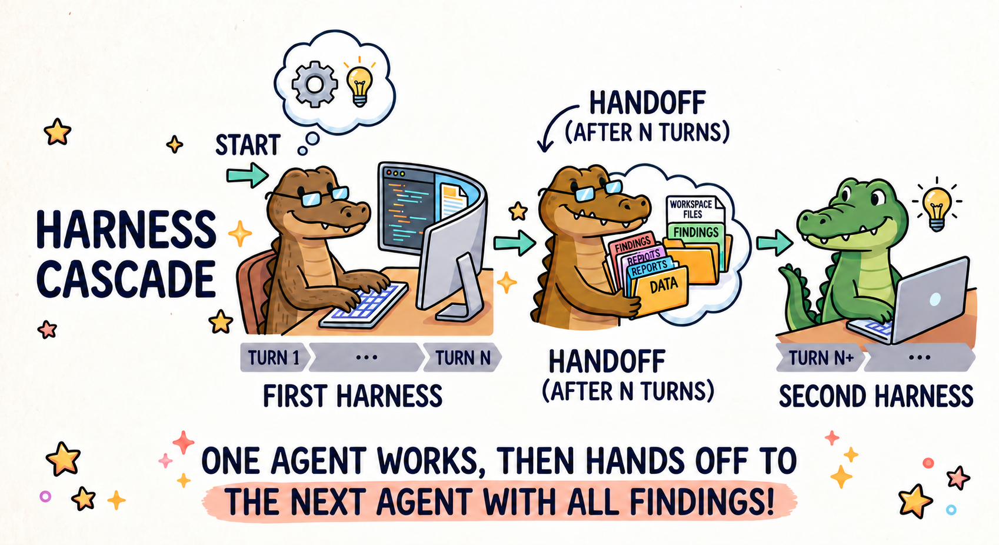

<div align="center">

# 🌊 Harness Cascade

**One agent starts the job. Another one finishes it.**

Run **Claude Code**, **Codex**, or **Pi** headlessly — on *any* model —
and hand a live workspace from one agent to the next mid-task.




</div>

## 🚀 Quick start

Cascade needs Python 3.11 or newer and [uv](https://docs.astral.sh/uv/). `uv` fetches a suitable Python if yours is older.

```bash
git clone https://github.com/ykwon0407/harness-cascade.git
cd harness-cascade
uv tool install .
export TOGETHER_API_KEY=...
```

You also need the CLI of each harness you use (`claude`, `codex`, or `pi`) on your `PATH`.

```bash
# Codex investigates for 5 tool turns, writes a handoff note,
# then Pi picks up in the same workspace and finishes the fix.
cascade --first codex:high --second pi:high --switch-after 5 \
  --model zai-org/GLM-5.3 \
  --workspace ~/my-project \
  -p "Find and fix the bug in auth.py"
```

The agents work in `--workspace`, which defaults to the current directory. Point it at the project you want changed, not at this repository. Add `--dry-run` to print the resolved plan without starting any agent.

### 🐍 From Python

`uv tool install` keeps cascade in its own environment, so `import harness_cascade` won't find it. Install the package into the environment your code runs in, for example a new virtualenv in your project:

```bash
uv venv --python 3.11
uv pip install --python .venv/bin/python /path/to/harness-cascade
```

`--python` matters when a conda environment is active, because `uv pip install` would otherwise install into conda. With an activated Python 3.11+ environment, `pip install /path/to/harness-cascade` works too.

Then call `harness_cascade.run` with the same arguments as the CLI:

```python
import harness_cascade

code = harness_cascade.run([
    "--first", "codex:high",
    "--second", "pi:high",
    "--switch-after", "5",
    "--model", "zai-org/GLM-5.3",
    "--workspace", "/path/to/my-project",
    "-p", "Find and fix the bug in auth.py",
])
```

- It runs the CLI as a subprocess (`python -m harness_cascade`) and returns its exit code: `0` on success, `1` for a failed run, `2` for a usage error, `128 + signal` when stopped (SIGTERM gives `143`).
- The subprocess inherits your standard streams and environment, including API keys and `PATH`.
- Call it from Python's main thread. It relays Ctrl-C, SIGTERM, and SIGHUP to the run, and raises `RuntimeError` from any other thread.
- Pass a list of arguments, not one string. For a large prompt, use `--prompt-file` and a path.

**[examples/](examples/)** has four runnable demos, each with its expected output and cost (a few cents each): the Python API, a solo CLI run, comparing pairings, and custom handoff prompts.

Things to try: let a careful harness explore and a fast one finish, swap the order to see which pairing lands more fixes, or drop `--second` and `--switch-after` to run one agent alone.

For supported harnesses and providers, architecture, configuration, and development details, see **[AGENTS.md](AGENTS.md)**.

## 🔁 How a handoff works

1. **Work:** the first agent runs until it has received `--switch-after` model replies that call a tool. This is the same unit for every harness. If it finishes earlier, the handoff still happens, unless you pass `--skip-second-if-finished`.
2. **Summarize:** the same session is resumed with tools off and asked for a handoff note.
3. **Snapshot:** Cascade records `git status`, the diff, and recent commands, trimmed when they are very large.
4. **Continue:** the second agent starts fresh with the task, the note, and the snapshot.

You can swap in your own prompts with `--summary-prompt` and `--continue-prompt`.

## 🗜️ Context compaction

Every harness gets the model's full context window and compacts once its context reaches 85% of it. Codex stops at 272k tokens even when 85% is more, as it does on its own. Left alone, they disagree: Claude Code assumes 200k for a model it doesn't know, Codex assumes 272k, and Pi uses the real window minus a 16k reserve. Change the threshold with `--compact-at 70`. Pass `--compact-at 0` to let each harness do its own thing.

A larger context makes each request bigger, which means more cost and latency per call. OpenAI charges more for GPT requests with input above 272k tokens; under Claude Code or Pi a GPT model still compacts at 85% of its 1.05M.

Each reply may be as long as the model allows (`max_output_tokens` in `model_profiles.yaml`), less whatever the context window has no room left for.

## 📦 Output

Choose `--output-format pretty` (colorful progress), `text` (just the answer), or `jsonl` (events). Each run is saved to `.cascade/runs/<run-id>/`.

## 🛠️ Development

```bash
uv sync --extra dev
uv run pytest
```

The tests use in-process fakes, so they never call a paid API. Two process-handling tests depend on Linux and fail on macOS.

---

<div align="center">

🤖 Working on this repo with a coding agent? Point it at **[AGENTS.md](AGENTS.md)**.

</div>
